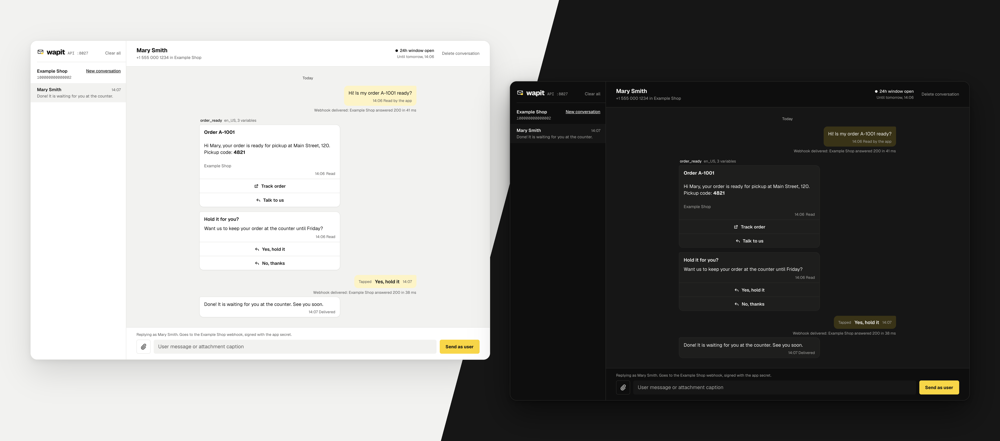

<p align="center">
  <picture>
    <source media="(prefers-color-scheme: dark)" srcset="docs/logo-dark.svg">
    
  </picture>
</p>

<h1 align="center">wapit</h1>

<p align="center">A local WhatsApp Cloud API for development: Mailpit, but for WhatsApp.<br><a href="https://wapit.patriciomartins.com.br">wapit.patriciomartins.com.br</a> · <a href="https://wapit.patriciomartins.com.br/docs/">Docs</a> · <a href="https://wapit.patriciomartins.com.br/llms.txt">llms.txt</a></p>

<p align="center">
  <a href="https://github.com/patriciomartinns/wapit/actions/workflows/ci.yml"></a>
  <a href="https://github.com/patriciomartinns/wapit/releases/latest"></a>
  <a href="LICENSE"></a>
  
</p>



Point your app's Graph API base URL at wapit and every message it sends shows up in an inbox that looks like a WhatsApp chat. wapit checks each send the way Meta does, answers with Meta's error codes, and lets you reply as the user: type a message, attach a file, tap a button, or mark a message delivered, read or failed. Each action reaches your app as a webhook signed with your app secret.

- One binary, no runtime, no external services. Data lives in a local SQLite file.
- Inbox on http://127.0.0.1:8026, Graph API on http://127.0.0.1:8027.
- Not affiliated with Meta or WhatsApp.

## Install

```bash
brew install patriciomartinns/tap/wapit
```

Or run the container:

```bash
docker run --rm -p 127.0.0.1:8026:8026 -p 127.0.0.1:8027:8027 \
  --add-host host.docker.internal:host-gateway -e WAPIT_LOOPBACK_HOST=host.docker.internal \
  ghcr.io/patriciomartinns/wapit
```

The last two options let wapit deliver webhooks to apps on your machine, such as `http://localhost:8000`, from inside the container.

Or build from source with Rust 1.89 or newer:

```bash
cargo install --locked --git https://github.com/patriciomartinns/wapit
```

Prebuilt binaries for macOS, Linux and Windows are on the [releases page](https://github.com/patriciomartinns/wapit/releases/latest). On Windows, download `wapit-<version>-x86_64-pc-windows-msvc.zip`, unzip it and run `wapit.exe`. Each release lists the SHA-256 of every archive in `SHA256SUMS`.

## Quick start

Run `wapit` with no configuration and it serves one default app:

| Setting | Value |
| --- | --- |
| Phone number id | `100000000000001` |
| WhatsApp Business Account id | `200000000000001` |
| Access token | `wapit-local-token` |
| App secret | `wapit-local-secret` |
| Webhook URL | `http://localhost:8000/webhook` |
| Webhook verify token | `wapit-verify-token` |

Set the same values in your app, with `http://127.0.0.1:8027` as the Graph API base URL, and send a message:

```bash
curl http://127.0.0.1:8027/v23.0/100000000000001/messages \
  -H 'Authorization: Bearer wapit-local-token' \
  -H 'Content-Type: application/json' \
  -d '{"messaging_product":"whatsapp","to":"15550000000","type":"text","text":{"body":"Hello"}}'
```

Open http://127.0.0.1:8026 to see it. A free-form message to someone who never wrote to you is accepted and then fails with error 131047, exactly as Meta does outside the 24-hour service window. Reply as the user from the inbox to open the window.

## Configuration

Copy `config/apps.example.json` to `config/apps.json` to describe your own apps. Each app is one WhatsApp phone number:

| Field | Meaning |
| --- | --- |
| `id` | Short name, also the name of its templates file |
| `name` | Name shown in the inbox |
| `phone_number_id`, `display_phone_number`, `waba_id` | The ids your app uses in Graph API paths |
| `access_token` | Bearer token your app sends |
| `app_secret` | Secret used to sign webhooks in `X-Hub-Signature-256` |
| `webhook_url` | Where wapit posts messages and statuses |
| `verify_token` | Optional. Lets the inbox run Meta's `hub.challenge` verification against your app |
| `auto_statuses` | Statuses fired after an accepted send. Defaults to `["sent"]` |
| `sync` | Optional. Where `wapit sync` reads real templates from |

The file reloads when it changes. If an edit breaks it, wapit keeps the last good version and shows the error in the inbox.

Templates live in `config/templates/<app id>.json`, in the format Meta's `message_templates` endpoint returns. Copy them from your real account, read-only, with:

```bash
WAPIT_SYNC_TOKEN=... wapit sync <app id>
```

This is the only command that talks to Meta, and only when you run it.

### Environment

| Variable | Default | Meaning |
| --- | --- | --- |
| `WAPIT_CONFIG_DIR` | `./config` | Where `apps.json` and `templates/` live |
| `WAPIT_DATA_DIR` | `./data` | SQLite database and media files |
| `WAPIT_HOST` | `127.0.0.1` | Address both servers bind to |
| `WAPIT_API_PORT`, `WAPIT_UI_PORT` | `8027`, `8026` | Ports |
| `WAPIT_PUBLIC_API_URL` | `http://127.0.0.1:8027` | Base of the media download URLs given to apps |
| `WAPIT_PUBLIC_UI_URL` | `http://127.0.0.1:8026` | Where a browser opening the API root is sent |
| `WAPIT_LOOPBACK_HOST` | | Host that receives webhooks whose host resolves to loopback. Set it to `host.docker.internal` in a container |
| `WAPIT_CA_CERTS` | | PEM file of extra certificate authorities trusted for webhooks, such as a local development CA |
| `WAPIT_ALLOWED_HOSTS` | | Extra host names the servers answer to, comma separated |
| `WAPIT_LOG` | `info` | Log filter, e.g. `wapit=debug` |

### Docker Compose

`compose.yaml` runs wapit with `config/` mounted and data in a named volume. To deliver webhooks to `https` sites signed by a local CA, such as Laravel Herd's `*.test` sites, add `compose.local-ca.yaml`:

```bash
WAPIT_CA_PEM="$HOME/Library/Application Support/Herd/config/valet/CA/LaravelValetCASelfSigned.pem" \
  docker compose -f compose.yaml -f compose.local-ca.yaml up -d
```

An app running in another container must reach wapit by a name that resolves there, such as `host.docker.internal:8027`, and media URLs follow `WAPIT_PUBLIC_API_URL`, so set it to that same address.

## What the Graph API mock covers

| Endpoint | Behavior |
| --- | --- |
| `POST /{phone_number_id}/messages` | Text, template, interactive (reply buttons, list, call to action URL), media, reaction, location, contacts. `status: read`, with an optional typing indicator |
| `POST /{phone_number_id}/media` | Uploads a file and returns its id. Only Meta's supported types are accepted, up to 5 MB for images, 16 MB for audio and video, 100 MB for documents and 500 KB for stickers |
| `GET /{media_id}`, `DELETE /{media_id}` | Media metadata with a download URL, and deletion |
| `GET /{waba_id}/message_templates` | The local templates, optionally filtered by `name` |
| `POST /{waba_id}/message_templates` | Creates a template, approved right away |
| `POST /{template_id}` | Edits a template's components or category |
| `DELETE /{waba_id}/message_templates?name=` | Deletes a template, or one language of it with `hsm_id` |
| `GET /{waba_id}`, `GET /{phone_number_id}` | Account and phone number fields, with an empty pricing analytics result |

A reaction gets only the `sent` status, as on Meta, and a reaction to a message that is not in the chat, is itself a reaction or is more than 30 days old is accepted and then fails with error 131009.

Template sends are checked against the stored template like Meta does: name and language (132001), paused or disabled templates (132015, 132016), parameter counts in the header, body and URL buttons (132000), line breaks or long runs of spaces in body parameters (132018), text too long after substitution (132005), header format (132012) and button index and type (131009). A rejected send returns Meta's error to your app and stays in the inbox, flagged, with the reason in plain words.

## Acting as the user

In a conversation you can type a message, attach a file, tap a reply, quick reply or list button, or select one of your app's messages to mark it delivered, read, played (voice messages only) or failed with a real Meta error code. Every action is posted to the app's webhook in Meta's payload format. As on Meta, the pricing object comes with the `sent` status and with the first of `delivered` or `read`, never with both. The inspector shows the payload your app sent, each webhook delivery with your app's response, and lets you send a webhook again. Apps with a `verify_token` can also run the subscription handshake from the inbox.

wapit delivers each webhook once. Unlike Meta, which retries a failed delivery, it does not retry on its own: if your app is down or answers with an error, the delivery is marked failed in the inspector and you send it again from there.

## Security

wapit has no authentication by design: it is a development tool for your own machine. It binds to `127.0.0.1`, only answers requests whose `Host` is a local name, so a web page cannot reach it through DNS rebinding, and its Graph API refuses writes that carry a browser's `Origin`, so a page you visit cannot send messages through it with the default token. Do not publish its ports beyond your machine. Report vulnerabilities as described in [SECURITY.md](SECURITY.md).

## Contributing

Bug reports and feature requests are welcome as issues. Pull requests are not accepted: see [CONTRIBUTING.md](CONTRIBUTING.md) for why and for what makes a good report.

## License

[MIT](LICENSE). The bundled Geist fonts are under the [SIL Open Font License](public/fonts/OFL.txt).

## Made by

<a href="https://github.com/patriciomartinns"></a>

**Patrício Martins**<br>
[@patriciomartinns](https://github.com/patriciomartinns)
